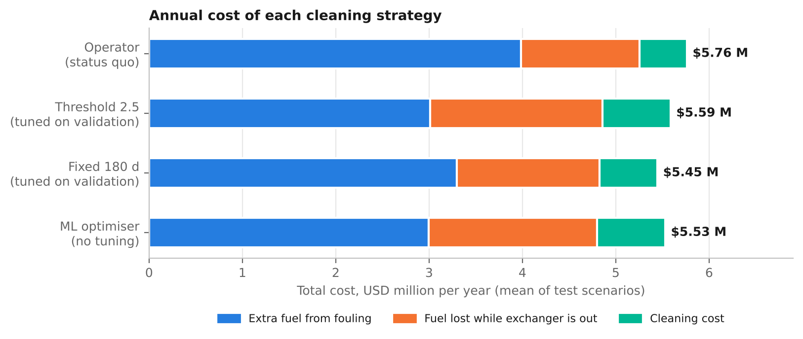
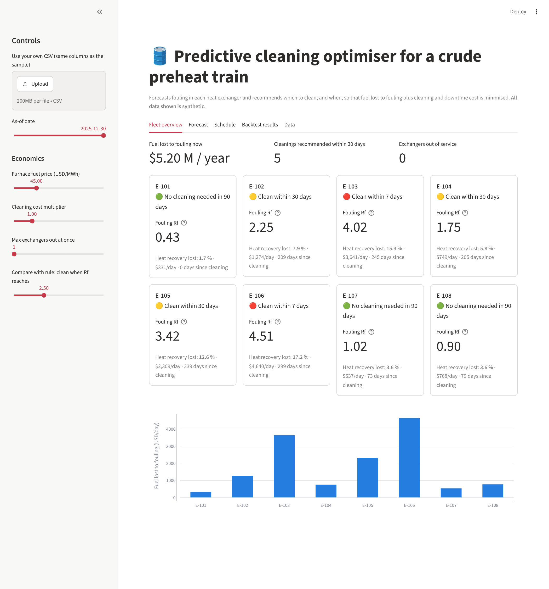
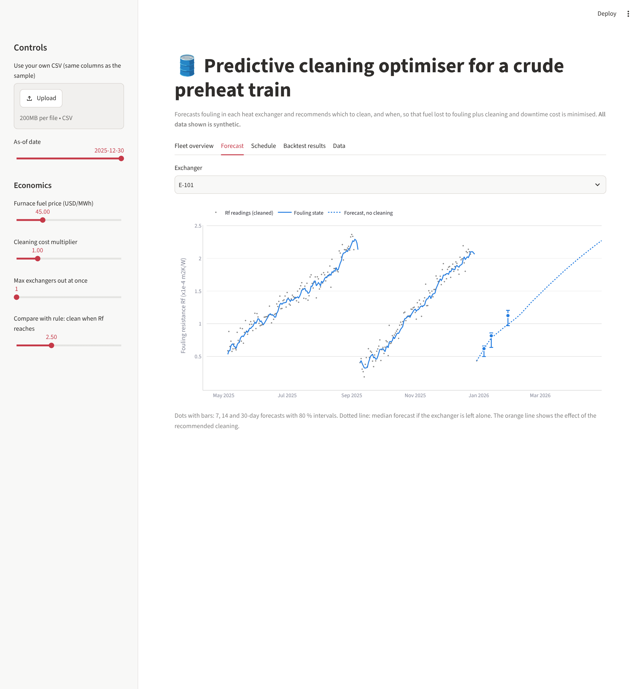
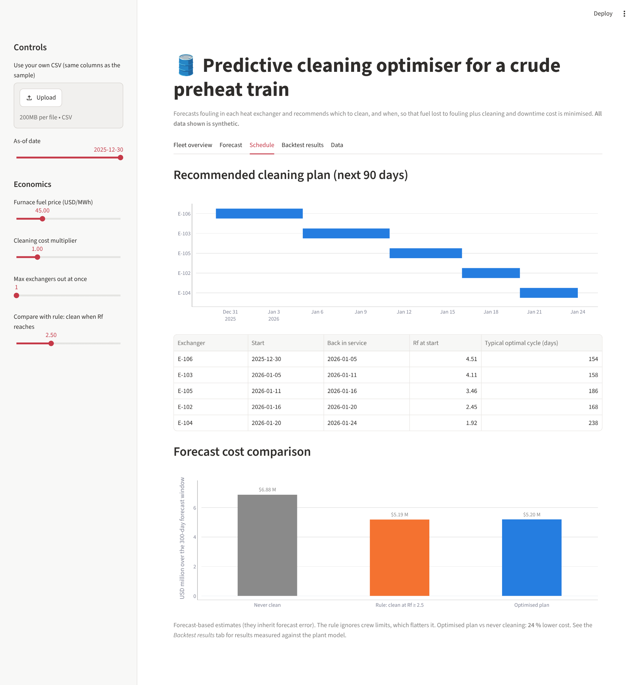

# Predictive cleaning optimisation for refinery heat exchanger networks

Crude preheat exchangers slowly foul, which makes the furnace burn extra fuel. Cleaning fixes it but costs money and
takes the exchanger out of service. This project **forecasts fouling for every exchanger** and **recommends which to
clean and when**, using a physics-informed Random Forest regression model and a mixed-integer scheduler, with a native desktop application and a full report.

> **Data is synthetic.** No real refinery data was used. `src/generate_data.py` generates it from a documented fouling
> model, so results show that the *method* works end to end, not that these savings would occur in a real plant.

## Results at a glance

Closed-loop simulation, 5 unseen test scenarios of 3 years each
(8 exchangers, one cleaning crew):

| Strategy | Cost per year | Cleanings per year |
|---|---|---|
| Never clean | $8.94 M | 0.0 |
| Operator (status quo) | $5.76 M | 12.4 |
| Fixed 180 d *(tuned on validation)* | $5.45 M | 15.7 |
| Threshold 2.5 *(tuned on validation)* | $5.59 M | 17.0 |
| ML optimiser | $5.53 M | 17.9 |

- The optimiser costs **4.0 % less than the status-quo operator policy**
  (about $233k per year; cheaper in 5 of 5 scenarios).
- Against simple rules whose setting was **tuned on separate validation scenarios** it is comparable
  (-1.6 % vs Fixed 180 d, +1.0 % vs Threshold 2.5; within scenario noise),
  but it needs no tuning, and a badly set fixed interval or threshold costs up to 7 % or 17 % more than its best setting.
- Forecast error is 41 % / 59 % / 68 % lower than a
  no-change forecast at 7 / 14 / 30 days on the held-out year.



## Desktop application

The project now includes a native desktop interface built with Tkinter. It does not use Streamlit or require VS Code to run. On Windows, double-click `Launch_Therma.bat`; it checks Python, installs the project dependencies, and opens the application. The first launch requires an internet connection for dependency installation. Python 3.10+ is required.

The desktop interface includes: a fleet overview and action centre; exchanger-level fouling forecasts; an optimised 90-day cleaning schedule with CSV export; a what-if studio for fuel price, cleaning cost, crew capacity and threshold assumptions; and a data explorer with CSV import, validation and export.







## Quick start

On Windows, **double-click `Launch_Therma.bat`**. It installs any missing dependencies and opens the desktop application. You do not need to open VS Code or run Streamlit. Python 3.10+ must be installed; the first launch needs an internet connection.

To regenerate the synthetic data, models, backtest and report from scratch, run `python run_all.py` from a terminal (this optional research workflow takes about four minutes).

`python run_all.py --skip-backtest` reuses the previous backtest. `pytest -q` runs the tests. All seeds are fixed, so
every run reproduces the same numbers.

## How it works

1. **Data** (`src/generate_data.py`): 3 years of daily readings for 8 exchangers with missing values, outliers and
   sensor drift. Fouling follows a Kern-Seaton asymptotic law driven by crude slate and flow.
2. **Features** (`src/features.py`): Hampel outlier filter, gap filling, run segmentation, rolling features, targets
   that never cross a cleaning or the train/test boundary.
3. **Forecast** (`src/forecast.py`): per-exchanger physical fouling law + Random Forest regression that learns how crude
   slate, flow and run age scale the rate; split-conformal calibrated 80 % prediction intervals.
4. **Optimiser** (`src/optimize.py`): rolls forecasts forward 300 days, prices every cleaning option, and solves a
   mixed-integer program (scipy/HiGHS) with a crew limit.
5. **Backtest** (`src/backtest.py`): runs every strategy day by day against the plant model on unseen scenarios.
6. **Report** (`src/make_report.py`): [`reports/report.pdf`](reports/report.pdf) / [`report.md`](reports/report.md).

```
app/desktop_app.py    Native desktop application (fleet, forecast, schedule, what-if, data)
Launch_Therma.bat     One-click Windows launcher
Run_Therma_with_console.bat  Diagnostic launcher
src/                  config, plant model, data generator, features, forecast, optimiser, backtest, evaluate, report
tests/                9 sanity tests (leakage, crew limit, accounting, determinism)
data/                 synthetic CSV and cleaning log
models/               trained forecasting models
reports/              report, results.json, figures
run_all.py            one command for everything
```

## Using your own data

Import a CSV from the desktop application, or replace `data/heat_exchanger_data.csv`, with the same columns:
`date, exchanger_id, status (online/cleaning), flow_m3h, crude_api, crude_sulfur_pct, fouling_resistance,
days_since_clean, cleaned (1 on the first day back in service)`. Exchanger ids must match `EX_ID` in `src/config.py`,
whose plant parameters (duty, cleaning cost, downtime) you should also update. Re-run `python run_all.py` to retrain.
The backtest needs a plant model, which is synthetic here; on real data you would validate the forecast and use
the optimiser's plan, not the simulated savings.

## Limitations

Synthetic data favours the forecast model (it shares the simulator's functional form); only 5
test scenarios, so 1-2 % differences are noise; prediction intervals cover less than the nominal 80 %; economics are
simplified (single fuel price, independent exchangers, no furnace limit); some scheduler design choices were made
while inspecting early backtest results. See the report, section 6.
