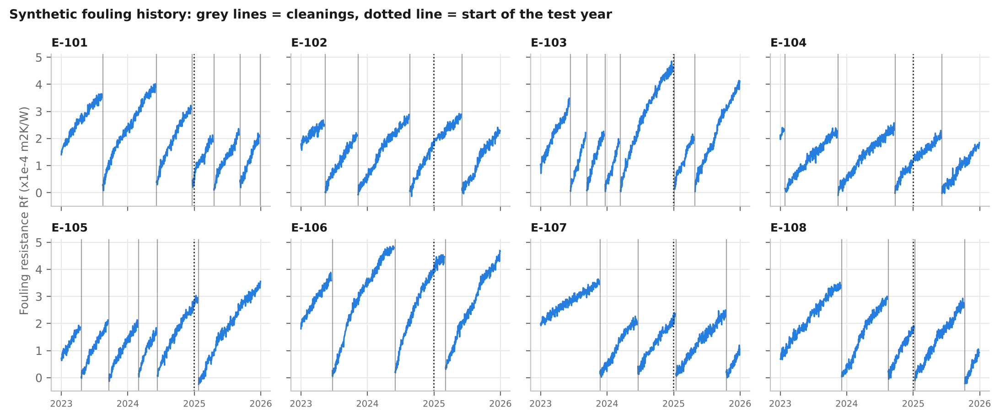
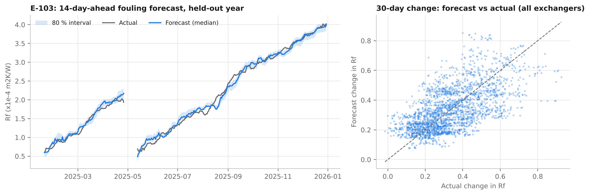
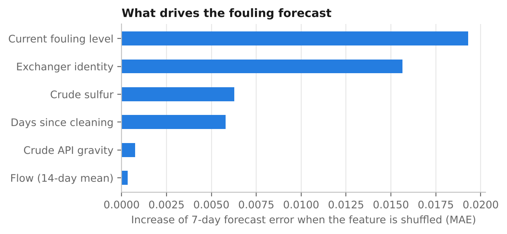
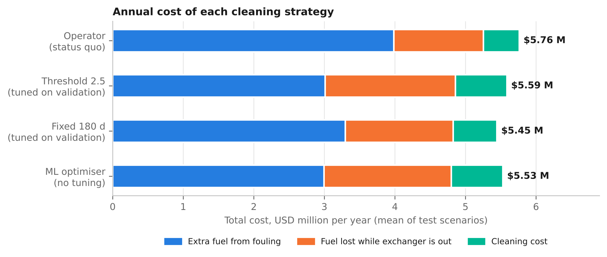
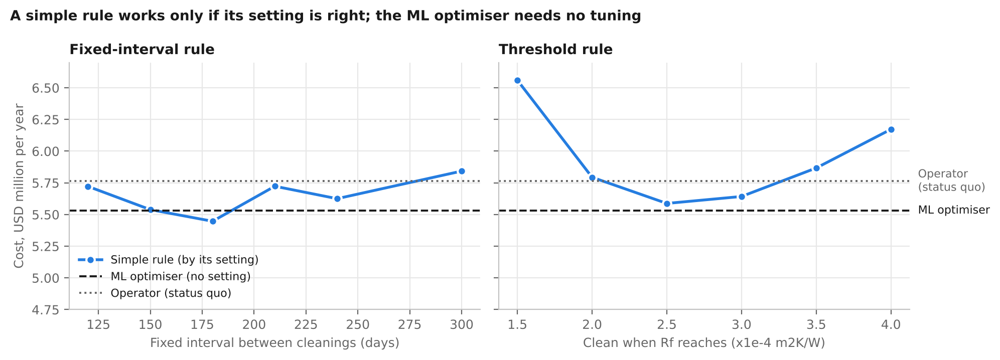
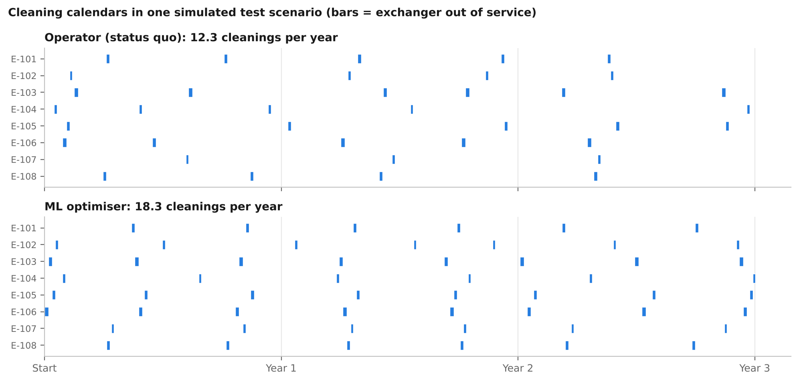

# AI-Driven Predictive Cleaning Optimisation for Refinery Heat Exchanger Networks

**Suzal Singh Patel  |  Registration No. INGF202412769**

*Project report. A study on synthetic data: no real refinery data was used.*

## Abstract

Crude preheat exchangers slowly foul, which forces the furnace to burn extra fuel; cleaning removes the fouling but costs money and takes the exchanger out of service. We build a two-stage decision-support system. A physics-informed gradient-boosting model forecasts the fouling resistance of every exchanger with calibrated 80 % prediction intervals, and a mixed-integer program turns those forecasts into a cleaning calendar that respects crew capacity. Because no plant data was available, the data is synthetic and produced by a documented fouling model. On the held-out year the 7, 14 and 30-day forecasts reduce error by 41 %, 59 % and 68 % relative to a no-change forecast. In a closed-loop simulation of 5 unseen 3-year scenarios the optimiser costs 4.0 % lower than the status-quo operator policy ($0.23 M per year, better in 5 of 5 scenarios). It is comparable to the best hand-tuned simple rules, within scenario-to-scenario noise (1.6 % higher than Fixed 180 d, 1.0 % lower than Threshold 2.5), but needs no tuning. The results show that the method works end to end on synthetic data; they do not establish performance on a real refinery.

## 1. Problem and motivation

In a refinery, crude oil is heated by a train of heat exchangers before it enters the furnace. Deposits (fouling) build up on the exchanger surfaces, which lowers heat recovery. The furnace makes up the difference by burning more fuel, which costs money and emits CO2. An exchanger can be taken out of service and cleaned, which restores performance, but cleaning has a fixed cost, the exchanger is bypassed for several days (during which its whole heat duty must be supplied by the furnace), and usually only a limited number of exchangers can be cleaned at the same time. The practical question is **which exchangers to clean, and when**.

Today this is often decided by fixed calendars or by an operator reacting to performance drops. A forecast-driven approach should do better because fouling speed differs between exchangers, depends on the crude slate being processed, and the cost of waiting grows non-linearly.

**Cost model.** The fraction of clean heat duty lost to fouling is `loss(Rf) = 1 - 1 / (1 + U0 * Rf * 1e-4)`, where Rf is the fouling resistance (units of 1e-4 m2K/W) and U0 the clean overall heat-transfer coefficient. The daily fuel penalty is `price * duty * 24 * loss(Rf)`. While an exchanger is out for cleaning, its whole duty is lost. Defaults: fuel price 45 USD/MWh, one exchanger out at a time, cleaning costs of 28-58 kUSD and 4-6 days of downtime per exchanger.

## 2. Data

**The data is synthetic.** `src/generate_data.py` produces 1095 days of daily readings for 8 exchangers (8,760 rows). Fouling resistance follows a Kern-Seaton asymptotic law whose rate depends on the crude slate (lower API gravity and higher sulfur foul faster) and on flow velocity (higher velocity fouls slower), with multiplicative process noise. Crude campaigns last 10-25 days. Temperatures, pressure drop and the soft-sensor fouling reading are derived from the fouling state. History was generated under an operator-style policy: an exchanger is cleaned a random 1-40 days after its fouling crosses a trigger that changes from one cleaning to the next, which produced 36 cleaning events and a wide range of fouling levels.

To make preprocessing meaningful, the data is deliberately imperfect: about 1.5 % of readings are missing, 0.4 % of fouling readings and 0.3 % of flow readings are outliers, the fouling soft-sensor drifts slowly, and exchangers have no readings while they are being cleaned. The first two years are used for training and the third year is held out for testing; no training target window reaches into the test year.

**Table 1. The simulated preheat train (illustrative values).**

| Exchanger | Duty (MW) | k (1e-4/day) | Plateau Rf* | Clean U (W/m2K) | Cleaning (kUSD) | Downtime (d) |
|---|---|---|---|---|---|---|
| E-101 | 18 | 0.024 | 5.0 | 400 | 38 | 5 |
| E-102 | 15 | 0.016 | 4.6 | 380 | 32 | 4 |
| E-103 | 22 | 0.030 | 6.0 | 450 | 52 | 6 |
| E-104 | 12 | 0.012 | 4.2 | 350 | 28 | 4 |
| E-105 | 17 | 0.020 | 5.4 | 420 | 36 | 5 |
| E-106 | 25 | 0.027 | 6.4 | 460 | 58 | 6 |
| E-107 | 14 | 0.014 | 4.4 | 360 | 30 | 4 |
| E-108 | 20 | 0.018 | 5.0 | 410 | 44 | 5 |

*Figure 1. Synthetic fouling history per exchanger.*

## 3. Methods

### 3.1 Preprocessing and features

Each exchanger series is split into runs at cleaning events. Within a run, outliers are removed with a Hampel filter (7-day window, 4 robust standard deviations) and gaps of up to 3 days are interpolated. The fouling **state** is the trailing 5-day mean of the cleaned reading within the current run. Features are the state, days since cleaning, 14-day mean flow, 5-day mean crude API gravity and sulfur, and the exchanger identity. Targets are the change of the state over the next 7, 14 and 30 days, using only windows without a cleaning.

### 3.2 Fouling forecast: physics-informed hybrid

A first version used plain gradient boosting. It forecast well one week ahead, but when rolled forward for months it systematically under-predicted fouling, because operators always cleaned before the plateau and a tree model cannot extrapolate beyond the fouling levels it has seen. The final model therefore combines physics and machine learning.

- **Physics.** For each exchanger a Kern-Seaton law `dRf/dt = beta (R* - Rf)` is fitted by least squares, giving the physically expected change over h days: `p_h = (R* - Rf)(1 - exp(-beta h))`.
- **ML.** Gradient boosting (scikit-learn `HistGradientBoostingRegressor`, quantile loss at 0.1, 0.5 and 0.9) learns the multiplier `actual change / p_h` from the crude slate, flow, run age and exchanger. The forecast is `p_h` times the multiplier, so long forecasts approach the plateau instead of running away.
- **Intervals.** The 80 % band is widened with split-conformal calibration on the last 120 training days (conformalised quantile regression, Romano et al. 2019).
- **Baselines.** Persistence (no change) and each exchanger's average historical change.

### 3.3 Cleaning optimiser

The 7-day median forecast is rolled forward 43 steps (301 days) for two cases per exchanger: left alone, and freshly cleaned. The current crude campaign is assumed to persist for about two weeks and then revert to the six-month average. From these trajectories the cost of cleaning exchanger i on day d is built from fuel lost before cleaning, the full duty lost while it is out, the cleaning cost, and the value of the rest of the window.

The value of the rest of the window needs care: a window that allows one cleaning per exchanger would otherwise push cleanings late. Following renewal theory, a freshly cleaned exchanger is valued at its best long-run cost rate `c*` per day, where `c*` is the minimum over cycle lengths a of `(cleaning + downtime + fuel lost during a days) / (a + downtime)`. Not cleaning for the whole window is compared with cleaning at the best day after the decision window. In a check on a set of freshly cleaned exchangers, each was scheduled within a few days of its own optimal cycle length (154-238 days across the train).

A mixed-integer program (scipy `milp`, HiGHS solver; Huangfu and Hall 2018) then chooses at most one start day per exchanger in the next 90 days, minimising total cost subject to at most M exchangers out of service on any day. In the backtest the plan is recomputed every 14 days (receding horizon), and only cleanings that start before the next replan are carried out.

### 3.4 Evaluation protocol

A fixed historical data set cannot say what would have happened under a different cleaning schedule, so strategies are compared in a **closed-loop simulation**: each strategy decides day by day, seeing only noisy fouling readings and history, and the plant model advances. All strategies face identical crude slate, throughput and noise within a scenario. Each of 5 test scenarios covers 3 years, starting from the plant state at the end of the data set. The same crew limit applies to every strategy. Strategies compared:

- **Never clean** (reference).
- **Operator (status quo):** the historical practice that generated the data.
- **Fixed interval** (120-300 days) and **threshold** (clean when Rf reaches 1.5-4.0) rules. The setting of each family is chosen on 3 separate validation scenarios; the test scenarios are only used to report. The best-in-hindsight setting on the test scenarios is shown too.
- **ML optimiser:** the system above, with no tuning.

## 4. Results

### 4.1 Forecast quality (held-out year)

**Table 2. Error in the change of fouling resistance (x1e-4 m2K/W). MAE = mean absolute error; gain = reduction of MAE; coverage = share of outcomes inside the model's 80 % interval.**

| Horizon | Test rows | MAE model | MAE mean rate | MAE persist. | Gain vs mean rate | Gain vs persist. | 80 % band coverage |
|---|---|---|---|---|---|---|---|
| 7 d | 2,771 | 0.054 | 0.061 | 0.091 | 11 % | 41 % | 73 % |
| 14 d | 2,643 | 0.066 | 0.079 | 0.160 | 16 % | 59 % | 71 % |
| 30 d | 2,377 | 0.107 | 0.120 | 0.336 | 10 % | 68 % | 60 % |

The model beats both baselines at every horizon. The gain over persistence grows with the horizon because fouling drifts steadily; the gain over each exchanger's historical average rate is smaller (10-16 %), so most of the predictable signal is the exchanger's own trend and the crude slate adds a smaller part. After conformal calibration the intervals cover 60-73 % of outcomes instead of the nominal 80 %: better, but still too narrow, because the held-out year differs from the calibration period.

**Table 3. Plateau recovered by the physics part from history in which exchangers were always cleaned early. Possible only because the data is synthetic.**

| Exchanger | Fitted plateau R* | True plateau (simulator) |
|---|---|---|
| E-101 | 4.71 | 5.0 |
| E-102 | 3.97 | 4.6 |
| E-103 | 6.35 | 6.0 |
| E-104 | 3.66 | 4.2 |
| E-105 | 3.81 | 5.4 |
| E-106 | 5.94 | 6.4 |
| E-107 | 4.42 | 4.4 |
| E-108 | 5.51 | 5.0 |

*Figure 2. Left: 14-day-ahead forecast for one exchanger with its 80 % interval. Right: 30-day changes, forecast against actual.*

*Figure 3. Permutation importance for the 7-day forecast.*

### 4.2 Cleaning strategies in closed-loop simulation

**Table 4. Mean annual cost over 5 test scenarios of 3 years each (USD).**

| Strategy | Total / year | Std dev (M) | Fouling fuel | Downtime | Cleaning | Cleanings / year |
|---|---|---|---|---|---|---|
| Never clean | $8.94 M | 0.13 | $8.94 M | $0.00 M | $0.00 M | 0.0 |
| Operator (status quo) | $5.76 M | 0.10 | $3.99 M | $1.27 M | $0.51 M | 12.4 |
| Fixed 180 d (tuned on validation) | $5.45 M | 0.14 | $3.30 M | $1.52 M | $0.62 M | 15.7 |
| Threshold 2.5 (tuned on validation) | $5.59 M | 0.08 | $3.01 M | $1.85 M | $0.73 M | 17.0 |
| ML optimiser | $5.53 M | 0.11 | $3.00 M | $1.81 M | $0.73 M | 17.9 |

*Figure 4. Annual cost split into its three components.*

**Table 5. Paired comparison across test scenarios (positive = ML optimiser is cheaper).**

| Comparison | Mean saving | Range over scenarios (%) | Scenarios won | USD k / year |
|---|---|---|---|---|
| ML vs Operator (status quo) | 4.0 % | 2.0 to 5.8 | 5 / 5 | +233 |
| ML vs Never clean | 38.1 % | 37.3 to 38.8 | 5 / 5 | +3,409 |
| ML vs Fixed 180 d | -1.6 % | -5.1 to 1.3 | 2 / 5 | -84 |
| ML vs Threshold 2.5 | 1.0 % | -1.3 to 3.0 | 3 / 5 | +57 |

*Figure 5. Cost of each simple rule as its setting changes.*

*Figure 6. Cleaning calendars in one test scenario.*

**Table 6. All strategies on the test scenarios, cheapest first.**

| Strategy | Total / year | Std dev (M) | Cleanings / year |
|---|---|---|---|
| Fixed 180 d | $5.45 M | 0.14 | 15.7 |
| ML optimiser | $5.53 M | 0.11 | 17.9 |
| Fixed 150 d | $5.54 M | 0.10 | 19.0 |
| Threshold 2.5 | $5.59 M | 0.08 | 17.0 |
| Fixed 240 d | $5.63 M | 0.11 | 12.3 |
| Threshold 3 | $5.64 M | 0.11 | 13.1 |
| Fixed 120 d | $5.72 M | 0.07 | 23.7 |
| Fixed 210 d | $5.72 M | 0.07 | 14.3 |
| Operator (status quo) | $5.76 M | 0.10 | 12.4 |
| Threshold 2 | $5.79 M | 0.13 | 22.8 |
| Fixed 300 d | $5.84 M | 0.17 | 9.7 |
| Threshold 3.5 | $5.87 M | 0.10 | 10.2 |
| Threshold 4 | $6.17 M | 0.08 | 7.4 |
| Threshold 1.5 | $6.56 M | 0.14 | 31.8 |
| Never clean | $8.94 M | 0.13 | 0.0 |

## 5. Discussion

- **Versus current practice** the optimiser lowers annual cost by 4.0 % on average, in 5 of 5 scenarios. It cleans more often than the operator (17.9 against 12.4 times per year), which costs more in downtime and cleaning but saves more fuel.
- **Versus tuned simple rules** there is no clear difference: 1.6 % higher than the best fixed interval and 1.0 % lower than the best threshold rule, with the sign changing between scenarios. The cost curve is flat near the optimum, so a well-tuned rule is hard to beat in this plant. Figure 5 shows the practical advantage: a badly set fixed interval costs up to 7 % more than the best interval and a badly set threshold up to 17 % more, while the optimiser needs no setting and adapts to each exchanger's fouling speed and to the crew limit.
- **Where the remaining gap comes from.** In a development diagnostic on two scenarios (not part of `run_all.py`), the same optimiser driven by a perfect-physics forecaster scored about the same as with the learned forecaster, and a rule that cleans each exchanger at its own optimal cycle length was slightly cheaper than both. This suggests the limit is the scheduling heuristic (the renewal-based value of the rest of the window), not forecast error.
- **Why the physics part mattered.** The plain machine-learning model could not extrapolate to fouling levels that history never reached; adding the asymptotic law cut the average under-prediction of fouling after 300 days from about 0.7 to about 0.2 (x1e-4 m2K/W), measured in a development check.

## 6. Limitations

- **Synthetic data.** The forecast model shares the asymptotic form of the simulator, so it is favoured; real fouling is messier. The results show the method works, not that these savings would occur in a refinery.
- **Small test set.** 5 scenarios; differences of 1-2 % between strategies are within scenario noise.
- **Interval coverage** is below the nominal 80 %.
- **Simplified economics.** One fuel price, no throughput or furnace-limit penalty, exchangers treated as independent (no hydraulic or thermal coupling), cleaning always restores a near-clean state.
- **Sensing in the backtest** is Gaussian noise on the fouling reading; outliers and gaps appear only in the offline data set.
- **Development was not fully blind.** Baseline settings were chosen on separate validation scenarios, but some scheduler design choices were made while inspecting early backtest results (including test scenarios 0 and 1).
- **Crude slate** is assumed unknown beyond the current campaign; a real planner may know the crude schedule.

## 7. Conclusion and future work

A forecast-then-optimise pipeline for heat-exchanger cleaning was built, tested and delivered with a dashboard. On synthetic data it reduces cost against status-quo practice and removes the need to tune cleaning rules. Next steps: test on real plant data; model dependencies between exchangers and furnace limits; plan under forecast uncertainty (use the prediction intervals inside the optimisation); and replace the renewal heuristic with a stronger long-horizon method such as stochastic or reinforcement-learning-based planning.

## References

- Kern, D. Q. and Seaton, R. E. (1959). A theoretical analysis of thermal surface fouling. British Chemical Engineering, 4(5), 258-262.
- Ebert, W. and Panchal, C. B. (1997). Analysis of Exxon crude-oil slip-stream coking data. In Fouling Mitigation of Industrial Heat-Exchange Equipment, Begell House.
- Georgiadis, M. C., Papageorgiou, L. G. and Macchietto, S. (2000). Optimal cleaning policies in heat exchanger networks under rapid fouling. Industrial and Engineering Chemistry Research, 39(2), 441-454.
- Smaili, F., Vassiliadis, V. S. and Wilson, D. I. (2001). Mitigation of fouling in refinery heat exchanger networks by optimal management of cleaning. Energy and Fuels, 15(5), 1038-1056.
- Romano, Y., Patterson, E. and Candes, E. (2019). Conformalized quantile regression. Advances in Neural Information Processing Systems 32.
- Pedregosa, F. et al. (2011). Scikit-learn: machine learning in Python. Journal of Machine Learning Research, 12, 2825-2830.
- Huangfu, Q. and Hall, J. A. J. (2018). Parallelizing the dual revised simplex method. Mathematical Programming Computation, 10(1), 119-142.

## Appendix: reproducing the results

`pip install -r requirements.txt`, then `python run_all.py` regenerates the data, models, backtest, figures and this report with fixed random seeds. `Launch_Therma.bat` starts the desktop application and `pytest -q` runs the tests.
